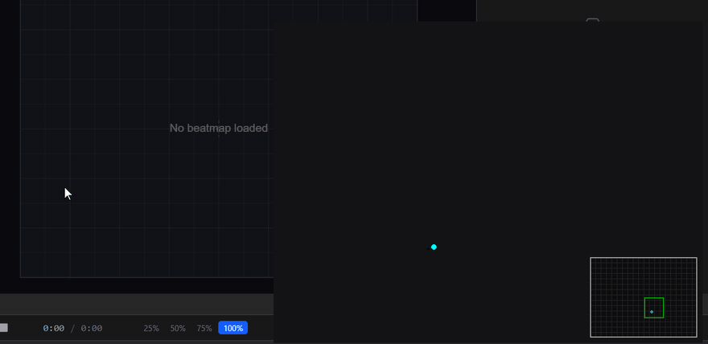

# Simple Cursor Tracker

A small Windows overlay that draws your pen or mouse movement as a fading trail, with a mini-map of your tablet's active area. It's made for **OpenTabletDriver** users who want to show their cursor movement on stream (osu!, drawing, tutorials).



**[⬇ Download the latest release](https://github.com/Kanorin-chan/Simple-Cursor-Tracker/releases/latest)** · Windows only

---

## What it does

- **Live cursor trail.** Your whole primary monitor is scaled into an 800×600 window, and the cursor leaves a smoothed trail that fades out.
- **Tablet mini-map.** It shows the full tablet surface, your active area as a rectangle, and where the pen is.
- **Automatic tablet detection.** On launch it briefly runs a bundled OpenTabletDriver daemon to identify your tablet. It then reads your area from OTD's `Settings.json` and the tablet's physical size from the bundled configuration files.
- **OBS-friendly modes.** You can switch to a borderless window and hide the UI, or the UI and the mini-map, so a window capture shows only the trail.
- **Customisable.** You can change the cursor, trail, rectangle and background colours (hex or colour picker), the trail length, smoothness and thickness, and the grids. You can save and load presets as JSON.

## Quick start

1. Download the latest release and extract it. The `.rar` needs 7-Zip or WinRAR.
2. Plug in your tablet.
3. Run `CursorTracker.exe`. On first launch it asks you:
   - **Which OTD `Settings.json` to use.** Choose **Yes** to use the default `%LocalAppData%\OpenTabletDriver\Settings.json`. The app remembers your choice.
   - **Which cursor settings preset to load.** On a first run you don't have one yet, so press **Cancel** to start with the defaults.
4. Move your pen. The trail appears in the main window and the dot moves on the mini-map.

Run `CursorTracker.exe -console` to keep the console open and see the detection log.

## Using it with OBS

Press **Alt** in the tracker window to open the overlay menu, then press a number:

| Key | Effect |
|---|---|
| `1` | Toggle a borderless window (no title bar) |
| `2` | Hide the UI and keep the mini-map. Press again to show it. |
| `3` | Hide the UI and the mini-map. Press again to show them. |

The number keys only work while the Alt menu is open. Pressing Alt again closes the menu.

In OBS, add a **Window Capture** of *Simple Cursor Tracking*. To remove the background, set a solid background colour in Settings (for example pure green `#00FF00`) and add a **Chroma Key** filter.

## Settings panel

Click **Settings** in the bottom-left corner to open the panel, and click **Close** to go back.

| Section | Options |
|---|---|
| Colours | Cursor, trail, active-area rectangle and background. Type a hex value or click a swatch to open the picker. |
| Trail | Trail on/off, fade on/off, length (5–50 points), smoothness (0.1–1.0, lower is smoother but lags more), thickness (1–10) |
| Rectangle | Active-area outline thickness (1–5) |
| Grid | Main-window grid, mini-map grid, show/hide the mini-map |
| Active Area (mm) | Read from OTD and locked by default. Click the shield 3 times within 3 seconds to unlock manual editing. |
| File | **Save** writes a preset JSON, **Load** opens one, **Reset** restores the defaults. |

## Files it creates

These are written next to the executable (or next to `cursortracker.py` when you run from source):

| File | Holds |
|---|---|
| `settings_config.json` | The path to your OpenTabletDriver `Settings.json` |
| `last_settings_path.json` | The last cursor preset you saved or loaded. It loads automatically on the next launch. |
| `cursor_settings.json` | The default name for a saved preset. You can save it anywhere. |

## Run from source

Requires Windows and Python 3.12 (the version it was tested on).

```bash
pip install -r requirements.txt
python cursortracker.py
```

`pywin32` is optional. It only brings the window back to the front after a file dialog closes.

### Build the executable

```bash
pip install pyinstaller
pyinstaller --onefile --console ^
  --add-data "Configurations;Configurations" ^
  --add-data "cursor_logo.png;." ^
  --add-data "cursor_logo.ico;." ^
  --add-data "OpenTabletDriver.CustomDaemon.exe;." ^
  --icon cursor_logo.ico ^
  --name "CursorTracker" cursortracker.py
```

The console is hidden at runtime unless you pass `-console`.

## Known issues

- **A file picker opens on every launch.** It happens until you save a preset once with **Save**. Pressing Cancel is safe.
- **The borderless window isn't always-on-top**, and you can't drag it. Position the window before you switch to borderless.
- **Very fast strokes look slightly angular.** The cursor is sampled once per frame (60 Hz).
- **With fade on, the trail fades toward black**, not toward your background colour. It can show a dark fringe on a chroma-key background.
- **The app crashes at startup if no tablet is detected** within about 3 seconds of launch (`NameError: target_tablet`). Plug the tablet in before you launch.

## Troubleshooting

- **Closes a few seconds after launch**: no tablet was detected (see Known issues). Plug the tablet in, then run with `-console` to see the detector output.
- **Wrong tablet size on the mini-map**: your model may be missing from `Configurations/`. The app asks you to pick a similar model.
- **Trail feels laggy**: raise *Smoothness* toward 1.0, or shorten the trail.

## Credits

- Tablet configuration files and the bundled detector daemon (`OpenTabletDriver.CustomDaemon.exe`, built from OpenTabletDriver 0.6.5.1) come from [OpenTabletDriver](https://github.com/OpenTabletDriver/OpenTabletDriver), licensed under **LGPL-3.0**.
- Built with [pygame](https://www.pygame.org/), pyautogui, numpy and psutil.
